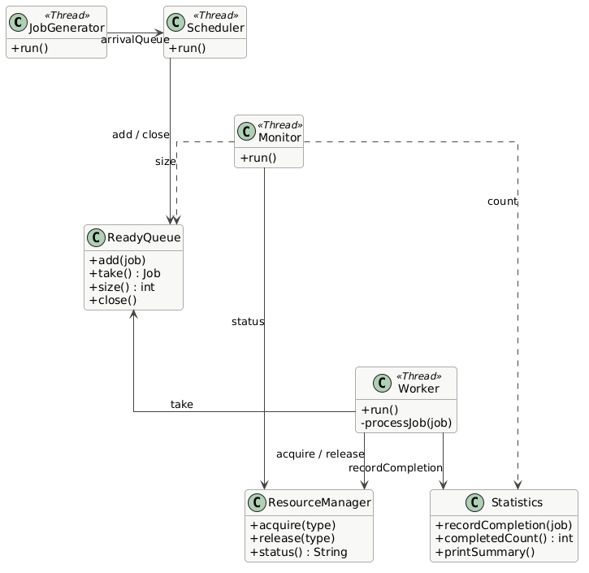
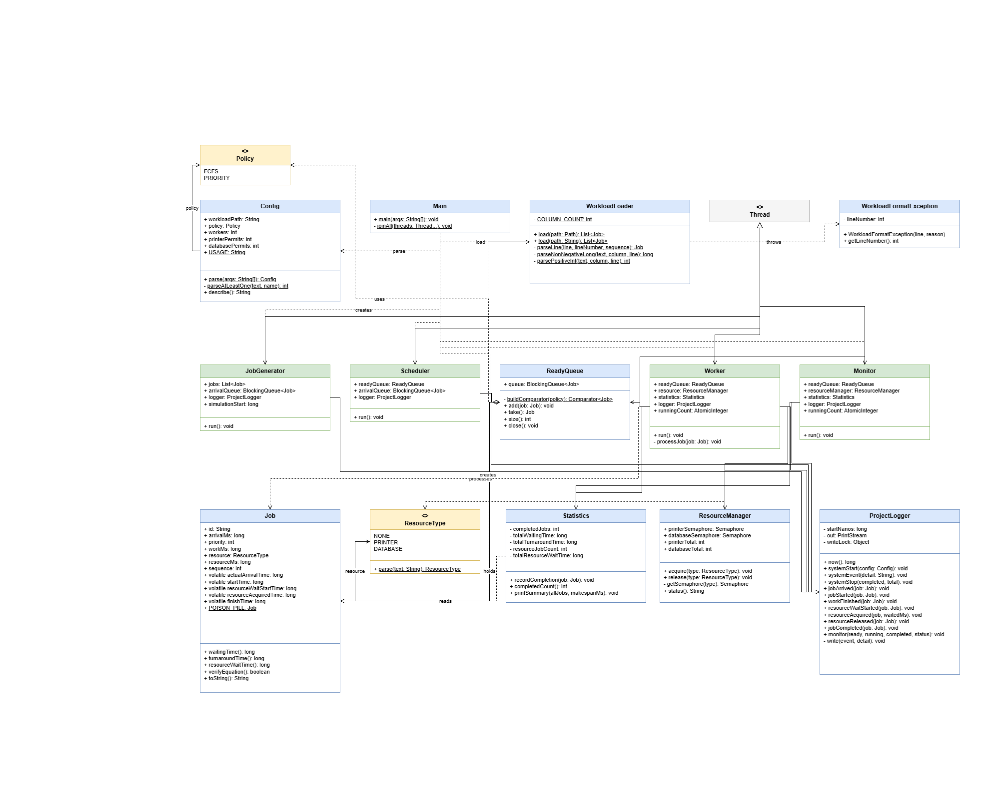

# วิธีการรันไฟล์
1. ให้เข้าไปที่โฟลเดอร์ src โดยใช้คำสั่ง

```bash
cd src
```
2. ใช้ไฟล์ที่ชื่อว่า LoadTestJobs.java ในการรันโดยใช้คำสั่งตามนี้

```bash
java LoadTestJobs.java data/ชื่อไฟล์.csv
```
3. ถ้าข้อมูลขึ้นแบบนี้แสดงว่ารันงานได้ถูกต้อง
 
```text
Loaded 10 job(s): 
 Job{id=J01, arrival=0, priority=5, workMs=2500, resource=NONE, resourceMs=0, seq=0}
 Job{id=J02, arrival=100, priority=5, workMs=2400, resource=PRINTER, resourceMs=1200, seq=1}
 Job{id=J03, arrival=200, priority=5, workMs=2500, resource=NONE, resourceMs=0, seq=2}
 Job{id=J04, arrival=300, priority=5, workMs=2400, resource=DATABASE, resourceMs=1000, seq=3}
 Job{id=J05, arrival=400, priority=5, workMs=2500, resource=PRINTER, resourceMs=1200, seq=4}
 Job{id=J06, arrival=500, priority=4, workMs=2400, resource=DATABASE, resourceMs=1000, seq=5}
 Job{id=J07, arrival=1000, priority=1, workMs=700, resource=PRINTER, resourceMs=900, seq=6}
 Job{id=J08, arrival=1200, priority=1, workMs=600, resource=PRINTER, resourceMs=900, seq=7}
 Job{id=J09, arrival=1400, priority=1, workMs=700, resource=DATABASE, resourceMs=900, seq=8}
 Job{id=J10, arrival=1600, priority=2, workMs=600, resource=NONE, resourceMs=0, seq=9}
```
4. รันแล้วเกิดแบบนี้แสดงว่าเราใช้ Path ผิดต้องทำใหม่

```text
Exception in thread "main" java.io.FileNotFoundException: \data\jobs_single.csv (The system cannot find the path specified)
        at java.base/java.io.FileInputStream.open0(Native Method)
        at java.base/java.io.FileInputStream.open(FileInputStream.java:219)
        at java.base/java.io.FileInputStream.<init>(FileInputStream.java:159)
        at java.base/java.io.FileInputStream.<init>(FileInputStream.java:112)
        at java.base/java.io.FileReader.<init>(FileReader.java:60)
        at WorkLoader.load(WorkLoader.java:11)
        at LoadTestJobs.main(LoadTestJobs.java:10)
```

## คำถามเน้นความเข้าใจ
1. ใช้เวลาจากนาฬิกาตัวไหน (ดู ProjectLogger.now() ซึ่งให้เวลาฐานเดียวกับที่ปรากฏใน log ทำให้ค่าที่วัดกับ log ตรวจสอบกันได้)
    - ANS: ใช้ ProjectLogger.now() เพียงตัวเดียวตลอดทั้งโปรแกรม
    - เหตุผล: ถ้าใช้ System.nanoTime()ในโค้ดแต่ log พิมนาฬิกาอีกตัวตัวเลขสองชุดนี้จะเทียบกันไม่ได้โดยตรงเพราะใช้นาฬิกาคนละตัว
    - สิ่งที่ต้องทำ: ทุกจุดที่ต้องบันทึกเวลาต้องเรียก ProjectLogger.now() เก็บค่านั้นไว้ ห้ามเรียกนาฬิกาของ JVM โดยตรง

2. ฟิลด์ใดถูกเขียนโดย Thread หนึ่งแล้วอ่านโดยอีก Thread หนึ่งและต้องป้องกันอย่างไร
    |Filed|Write|Read|เหตุผล|
    |-----|-----|----|-----|
    |actualArrivalTime|Dispatcher/Producer Thread thread ที่ปล่อยงานเข้าคิวตามเวลา arrivalMs|Worker Thread หยิบงานนี้ไปคำนวณ Waiting|งานที่ถูกสร้างและปล่อยเข้าคิวโดย Thread หนึ่ง แต่ถูกหยิบไปประมวลผลโดย Thread อีกตัว|
    |startTime|Worker thread|Worker thread เดิม คำนวณ waiting ทันทีและ Thread ที่มาสรุปผลรวมตอนท้ายคือ main thread หรือ stats collector|เขียนครั้งเดียวตอนเริ่ม อ่านซ้ำตอนสรุปรายงาน|
    |resourceWaitStartTime, resourceAcquiredTime|Worker Thread ตอนขอได้ resource จาก resource manager ใช้ร่วมกันหลาย Thread| Worker Thread, Thread สรุปผล|เหมือนกัน|
    |finishTime|Worker thread|Main thread, stats thread ที่รอ join แล้วมาพิมรายงาน|เป็น filed ที่สำคัญที่สุด เพะราใช้ในการคำนวณ Turnaround|

    - วิธีป้องกัน มีอยู่ 4 กรณี
        1. อ่านหลังจาก worker thread นั้นทำงานเสร็จสมบูรณ์แล้วเท่านั้น
            - ตัวอย่าง: 
                ```text
                main thread เรียก thread.join() หรือใช้ ExecutorService แล้ว awaitTermination()/Future.get() ก่อนจะไปอ่านค่าจาก Job object
                ```
            - ป้องกัน: ไม่ต้องใช้ volatile หรือ synchronized
            - สาเหตุ: 
                ```text
                    Thread.join() และ Future.get() สร้าง happens-before relationship ให้เองตาม Java Memory Model: ทุกอย่างที่ thread ลูกเขียนก่อน terminate จะถูกมองเห็นโดย thread ที่ join สำเร็จแล้ว
                ```
        
        2. อ่านค่าแบบ "สด" ระหว่างที่ worker ยังทำงานอยู่
            - ตัวอย่าง: 
                ```text
                ทำ live dashboard, มี thread ที่คอย poll สถานะงานระหว่างรัน หรือ progress bar
                ```
            - ป้องกัน: ใช้ volatile กับทุก field
            - สาเหตุ: 
                ```text
                ไม่มี synchronization point ใดๆ คอยการันตี visibility — thread อ่านอาจเห็นค่า default (0) ค้างอยู่ทั้งที่ worker เขียนไปแล้ว
                ```
        
        3. ใช้ queue ส่งต่องาน
            - ตัวอย่าง:
                ```text
                    producer ใส่ actualArrivalTime แล้ว put ลง BlockingQueue, worker take() ออกมา
                ```
            - ป้องกัน: ไม่ต้อง volatile สำหรับ actualArrivalTime
            - สาเหตุ: 
                ```text
                    BlockingQueue.put()/take() มี happens-before guarantee ในตัวอยู่แล้วแต่ field ที่ worker เขียนเองทีหลังต้องดูตามกรณี 1/2 ข้างบนแยกกัน
                ```
        4. กรณีที่ไม่มั่นใจเรื่องโครงสร้าง
            - ป้องกัน: ใส่ volatile ใส่ทุก filed ที่เราสร้างขึ้น

3. ทำไมใช้ PriorityBlockingQueue เป็นฐานเดียวรองรับทั้ง FCFS และ Priority
    - ANS: 
        ```text
            PriorityBlockingQueue คือ blocking queue ที่เรียงลำดับตาม Comparator เสมอ ถ้าให้ comparator เรียงตาม sequence อย่างเดียว ผลลัพธ์ก็คือพฤติกรรมแบบ FIFO
        ```

4. ทำไม tie-break ใช้ sequence ไม่ใช้เวลาจริง (actualArrivalTime หรือ System.nanoTime())
    - ANS: 
        ```text
            ถ้าใช้เวลาจริงในการตัดสิน ผลลัพธ์อาจสลับกันไปมาระหว่างการรันแต่ละครั้งเพราะ OS scheduling ของ Thread ไม่ deterministic
            sequence เป็นค่า final ที่ตั้งตายตัวตั้งแต่อ่านจากไฟล์ CSV จึงให้ผลเหมือนเดิมทุกครั้งที่รันด้วย workload เดียวกัน
        ```

5. ทำไม take() แค่ return queue.take() เฉยๆ โดยไม่เช็ค poison pill เอง
    - ANS:
        ```text
            ReadyQueue เป็น โครงสร้างข้อมูลทั่วไป ไม่ควรรู้จัก "ความหมาย" ของ poison pill หน้าที่คือเช็คว่า "นี่คือสัญญาณจบหรือ Job จริง" ควรอยู่ที่ Worker
        ```

6. ทำไมต้องใส่ poison pill "เท่ากับจำนวน Worker" 
    - ANS:
        ```text
            queue.take() เป็น consume แบบตัวใครตัวมัน
        ```
    - ตัวอย่าง:
        ```text
            pill 1 ตัวจะถูก Worker เพียงตัวเดียวหยิบไปแล้วหายจาก queue ถ้ามี Worker 5 ตัว ต้องมี pill 5 ตัว ไม่งั้น Worker ตัวที่ไม่ได้ pill จะ block ค้างอยู่ที่ take() ตลอดไป โปรแกรมจะไม่จบ
        ```
7. ทำไม size() ไม่ต้องเขียน synchronized เอง
    - ANS:
        ```text
            PriorityBlockingQueue.size() เป็น thread-safe อยู่แล้วในตัว internal lock จัดการให้ จึงเรียกตรงๆ ได้เลยโดยไม่ต้องเพิ่ม synchronization ชั้นนอกอีกชั้น
        ```

8. ทำไมใน ReadyQueue.buildComparator ต้องเขียนเช็ค POISON_PILL แยกออกมาต่างหาก ถ้าไม่เช็คจะเกิดอะไรขึ้น
    - ANS: 
        ```text
            pill มีค่า priority/sequence = -1 ซึ่งเป็นค่าที่ไม่ได้มีความหมายเป็น "งานสำคัญที่สุด" แต่ดันชนะทุก comparator ปกติถ้าไม่แยกเช็ค pill จะโดน sort ขึ้นไปแซงหน้า Job จริงทุกตัว ทำให้ Worker หยุดทั้งที่ยังมีงานค้าง
        ```
9. อธิบายกลไก "poison pill relay" ใน Worker.run() — ทำไม Scheduler ใส่ pill แค่ 1 ใบ แต่ Worker N ตัวหยุดได้ครบทุกตัว
    - ANS: 
        ```text
            pill ไม่ได้หยุด Worker ทุกตัวพร้อมกัน แต่แต่ละตัวที่เจอ pill จะ 'ส่งต่อ' ให้ตัวถัดไปก่อนตายเอง โดยเรียก readyQueue.close() ใส่ pill กลับเข้าคิวอีกใบทุกครั้งที่เจอ ทำให้เกิดเป็นลูกโซ่ ไปจนกว่า Worker ตัวสุดท้ายจะได้รับและหยุดตัวเอง วิธีนี้ทำให้ Scheduler ไม่ต้องรู้จำนวน Worker ล่วงหน้า
       ```

10. ทำไม Job ใช้ volatile กับ field เวลาแทนที่จะใช้ synchronized หรือ AtomicLong
    - ANS: 
        ```text
            เพราะ filed เวลาถูกเข้าถึงหรือแก้ไขโดย Thread หลายๆ Thread พร้อมกัน เพื่อป้องกันปัญหา Race Condition 
            ต้องอ่านค่าล่าสุดที่ Worker เขียนไปให้ได้แน่นอน ไม่ใช่ค่าที่ค้างอยู่ใน cache ของ core อื่น
        ```

11. ResourceManager.acquire() ไม่มี try/catch ครอบ แต่ Worker.processJob() ใช้ try/finally ครอบเฉพาะช่วง sleep หลัง acquire — ถ้า interrupt เกิดขึ้น ระหว่าง acquire() เอง (ยังไม่ได้ permit) จะเกิดอะไร ต้อง release ไหม
    - ANS:
        ```text
            ไม่ต้อง release ครับ เพราะ Semaphore.acquire() เป็น atomic operation แบบ all-or-nothing — ถ้าถูก interrupt ระหว่างรอ มันจะ throw InterruptedException ทันทีโดยไม่ได้ permit ไปเลย ไม่มีสถานะกึ่งได้กึ่งไม่ได้ เพราะฉะนั้นไม่มี permit ค้างให้ต้องคืน exception จะถูกโยนทะลุขึ้นไปจนถึง Worker.run() ซึ่งจับไว้แล้ว set interrupt flag แล้วให้ thread จบตัวเอง ส่วน try/finally ที่มีอยู่ตอนนี้ถูกวางไว้ถูกจุดแล้ว คือครอบเฉพาะช่วงหลัง acquire สำเร็จจนถึงก่อน release ซึ่งเป็นช่วงเดียวที่ permit อยู่ในมือเราจริง ๆ ถ้าไปใส่ release ครอบ acquire ด้วยจะกลายเป็นบั๊กที่ทำให้ permit เกินจำนวนจริงแทน"
        ```
    - กลไกSemaphore.acquire()
        ```text
        java.util.concurrent.Semaphore.acquire() มี contract ที่ชัดเจนมาก:

        ถ้า thread ถูก interrupt ระหว่างรอ permit มันจะ throw InterruptedException ทันที และ ไม่ได้ permit ไปเลย ไม่มีการ "ได้ permit มาแล้วแต่โยน exception ทีหลัง"
        พูดง่าย ๆ คือ acquire() เป็น operation แบบ all-or-nothing:

        สำเร็จ → ได้ permit ไป 1 หน่วยแน่นอน
        ล้มเหลว (throw exception) → ไม่ได้ permit อะไรเลย ไม่มีอะไรค้างให้ต้องคืน    
        ```

12. ถ้าเปลี่ยนโครงสร้าง JobGenarator.java โดยการ Implements Runnable ต้องแก้จุดไหนบ้าง
    - ANS: 
        ```text, java
            แก้ไขไฟล์ JobGenaerator.java ให้ทำการ Implements 
            เอา super() ออกจาก constructor

            แก้ที่ Main.java โดย code นี้
                JobGenerator jobGenerator = new JobGenerator(jobs, logger, arrivalQueue, simulationStart);
                Thread gen = new Thread(jobGenerator, "generator");
                gen.start();

            รอจนกว่างานทั้ง jobs.size() ชิ้นจะเสร็จ ต้องแก้เป็น 
                joinAll(gen, scheduler);
        ```

## วิธี redirect log ลงไฟล์
1. สร้างโฟลเดอร์ logs ภายในโฟลเดร์ src
2. รันคำสั่ง java Main workloads/jobs_standard.csv fcfs 3 1 2 > logs\ชื่อไฟล์.log มันจะทำการเขียนไฟล์ .log ในโฟลเดอร์ logs
3. วิธีนับ jobCompleted ใช้คำสั่ง
    ```bash
    findstr /c:"JOB_COMPLETED" logs\standard_fcfs_w3.log | find /c /v ""
    ```
4. วิธีนับ "RESOURCE_ACQUIRED" ใช้คำสั่ง
    ```bash
        findstr /c:"RESOURCE_ACQUIRED" logs\standard_fcfs_w3.log | find /c /v ""
    ```
5. วิธีนับ RESOURCE_RELEASED
    ```bash
        findstr /c:"RESOURCE_RELEASED" logs\standard_fcfs_w3.log | find /c /v ""
    ```
6. วิธีดูว่าช่วงใดที่ PRINTER ถูกถือเกินจำนวน permit ใช้คำสั่ง
    - เข้าไปที่โฟลเดอร์งาน 
    ```bash
        cd path
    ```
    - ตรวจสอบ
    ```powershell
        $log = "logs\standard_fcfs_w3.log"
        $permits = @{ PRINTER = 1; DATABASE = 2 }   # ให้ตรงกับ argument ที่รัน
        $cur = @{ PRINTER = 0; DATABASE = 0 }
        $max = @{ PRINTER = 0; DATABASE = 0 }

        Get-Content $log | ForEach-Object {
        if ($_ -match 'RESOURCE_ACQUIRED\s+job=\w+ resource=(\w+)') {
        $r = $Matches[1]; $cur[$r]++
        if ($cur[$r] -gt $max[$r]) { $max[$r] = $cur[$r] }
        }
        elseif ($_ -match 'RESOURCE_RELEASED\s+job=\w+ resource=(\w+)') {
        $cur[$Matches[1]]--
        }
    }

    foreach ($r in "PRINTER","DATABASE") {
        $ok = if ($max[$r] -le $permits[$r]) { "OK" } else { "เกิน!" }
        "$r  max พร้อมกัน=$($max[$r])  permit=$($permits[$r])  $ok"
    }
    ```


## ผลที่ได้ 
|#|Workload / Policy|Workers|Printer|DB|avg WatingTime|avg Turnaround Time|Throughput|avg RW|
|----|-----|----|-----|-----|-----|-----|-----|-----|
|1|standard / FCFS |3|1|2|2957|5462|1.14|73|
|2|standard / Priority|3|1|2|2326.00|4960.00|1.08|260|
|3|standard / Priority|1|1|2|8533|10989|0.41|1.00|
|4|standard / Priority|5|1|2|1125|4083|1.29|725|
|5|printer / Priority|3|1|2|1141|4247|0.79|1614|
|6|printer / Priority|3|2|2|760|2547|1.42|298|
|7|standard / Priority|3|1|2|2331|4967|1.08|259|

## priority VS FCFS (Scheduling)
- Priority WT = timestamp(JOB_STARTED) − timestamp(JOB_ARRIVED)
- FCFS WT = timestamp(JOB_STARTED) − timestamp(JOB_ARRIVED)
- ผลต่าง = Priority WT - FCFS WT
- ถ้าค่าผลต่างติดลบแปลว่า ได้ประโยชน์ Priority รอน้อยกว่า FCFS
- ถ้าผลต่างเป็นบวกแปลว่า เสียประโยชน์  Priority รอนานกว่า FCFS
- ถ้าผลต่าง <= 5 แปลว่าไม่ต่างกัน


|Job|priority|Arrived|FCFS start|FCFS WT|Priority start|Priority WT|ผลต่าง priority - FCFS|
|-----|------|-----|-------|----|----|-----|-----|
|j01|5|30|36|6|37|6|0|
|j02|5|128|129|1|134|3|+2|
|j03|5|228|228|0|231|0|0|
|j04|5|328|2550|2222|5377|5046|+2824|
|j05|5|427|2740|2313|5564|5134|+2821|
|j06|4|535|3747|3212|5267|4726|+1514|
|j07|1|1027|5962|4935|2538|1507|-3428|
|j08|1|1227|6467|5240|2734|1502|-3738|
|j09|1|1427|7162|5735|3750|2319|-3416|
|j10|2|1637|7591|5954|4655|3025|-2929|

#### job ไหนได้ประโยชน์
- ANS: j07, j08, j09, j10
#### Job ไหนมีผลกระทบ
- ANS: j04, j05, j06
#### Job ไหนที่ไม่ต่าง
- ANS: j01, j02, j03


## Worker Count 
- หลักการเช็ค "สัดส่วน" คือถ้า worker เพิ่มเป็น N เท่า Throughput ควรเพิ่มเป็น N เท่าด้วย
- Throughput_คาดหวัง = Throughput_เดิม × (Worker_ใหม่ / Worker_เดิม)
- % ที่ได้จริง = (Throughput_จริง / Throughput_คาดหวัง) × 100

|Worker|Throughput|Average Resource Wait Time|สัดส่วน|
|-----|-----------|--------------------------|------|
|1|0.41|1.00|100%|
|3|1.08|260.00|88%|
|5|1.29|725.00|63%|

- สรุป:
    ```text
        เมื่อจำนวน worker 3-5 มีสัดส่วนที่น้อยลงมา เพราะว่า ระบบเริ่มเข้าใกล้ resource-bound มากกว่า worker-bound — ยิ่งเพิ่ม Worker จำนวน Job ที่พร้อมทำงานพร้อมกันยิ่งมาก แต่จำนวน permit ของ PRINTER (=1) และ DATABASE (=2) ยังคงเดิม ทำให้เกิดการแย่ง resource รุนแรงขึ้น สังเกตได้จาก avg Resource Wait ที่พุ่งขึ้นจาก 260ms เป็น 725ms (เกือบ 3 เท่า)
    ```


## จุดคอขวดของ resource 
- % ที่ลดลงของ avg RW = (RW_permit1 − RW_permit2) / RW_permit1 × 100
- % ที่เพิ่มของ Throughput = (TP_permit2 − TP_permit1) / TP_permit1 × 100

|printer|avg Resource Wait Time|Throughput|
|----------|----------------------|----------|
|1|1614.00|0.79|
|2|298.00|1.42|

- % ที่ลดลงของ avg RW = 81.5%
- % ที่เพิ่มของ Throughput = 79.7%

- สรุป จุดคอขวดของระบบย้ายไปอยู่ที่ใด
    ```text
        ถ้า avg RW เข้าใกล้ 0 → แปลว่า PRINTER เลิกเป็นคอขวดแล้ว
        ถ้า avg RW ไม่เข้าใกล้ 0 → แปลว่า PRINTER ยังเป็นคอขวดอยู่บางส่วน

        permit = 2 avg Resource wait ไปที่ 298 ms ยังไม่เข้าใกล้ 0 ดังนั้นยังเป็นคอขวดอยู่บางส่วน
    ```

- สรุป avg Resource Wait and Throughput เปลี่ยนอย่างไร
    ```text
        เมื่อเพิ่มจำนวน printer permit จาก 1 เป็น 2 avg Resource Wait Time ลดลงจาก 1614.00 จนถึง 298.00 คิดเป็น % ได้ 81.5% ของการลดลงของ avg RW ในส่วนของ Throughput เพิ่มขึ้นจาก 0.79 ถึง 1.42 คิดเป็นเปอรืเซ็นที่เพิ่มได้ 79.7%
    ```

## คำถาม Demo

1. เพิ่ม Worker จาก 3 เป็น 5 แล้ว Throughput เพิ่มตามสัดส่วนหรือไม่ และ avg Resource Wait เปลี่ยนอย่างไร เพราะอะไร?
    - ANS: 
        ```text
            หลังจากเพิ่ม worker จาก 3 เป็น 5 ทำให้สัดส่วน Throughput ลดลงมาเนื่องจาก ระบบเริ่มเข้าใกล้ resource-bound มากกว่า worker bound
            ทำให้เกิดการแย่ง resource มากขึ้น สามารถดูได้จาก avg Resource Wait Time ที่พุ่งขึ้นมาเป็น 3 เท่า
        ```

2. FCFS กับ Priority ทำให้ Job กลุ่มใดได้ประโยชน์หรือเสียประโยชน์จาก jobs_standard.csv? ให้อ้างอิง Waiting Time และลำดับ START ใน log และอธิบายด้วยว่าเหตุใด Priority Scheduling ในการทดลองนี้อาจมี Throughput ต่ำกว่า FCFS แม้ค่าเฉลี่ย Waiting Time จะดีกว่า  
    - ANS:
        ```text
            กลุ่มที่ได้ประโยชน์: j07, j08, j09, j10 (priority 1-2) WT ลดลง 2,929-3,738 ms
            กลุ่มที่เสียประโยชน์: j04, j05, j06 (priority 4-5) WT เพิ่มขึ้น 1,514-2,824 ms
            กลุ่มที่ไม่ต่าง: j01, j02, j03 เริ่มทันทีเพราะ worker ว่าง (ผลต่าง ≤ 5 ms)

            ลำดับ START ใน Priority log: J01, J02, J03, J07 (2538), J08 (2734), J09 (3750),
            J10 (4655), J06 (5267), J04 (5377), J05 (5564) ms
            job priority สูงกว่าแซงคิว j04-j06 แม้มาถึงทีหลัง

            Avg WT ของ Priority ดีกว่า (2326 vs 2961 ms) แต่ Throughput ต่ำกว่า (1.08 vs 1.14 jobs/sec)
            เพราะ Priority ไม่ดูความยาวงาน job ยาว (j04, j05, j06) ถูกเลื่อนไปเริ่มท้ายสุด
            ทำให้ job สุดท้ายเสร็จที่ 9277 ms (FCFS 8779 ms) และช่วงท้ายเหลือ worker ทำงานตัวเดียว
            นอกจากนี้ j07/j08 แย่ง PRINTER ตัวเดียวกัน (j08 รอ 1307 ms) ทำให้ Avg Resource Wait สูงขึ้นเป็น 260 ms (FCFS 73 ms)
            Throughput วัดจากเวลารวมที่ job สุดท้ายเสร็จ ไม่ใช่เวลารอเฉลี่ย
        ```


3. เมื่อเพิ่ม Printer permit จาก 1 เป็น 2 แล้ว avg Resource Wait และ Throughput เปลี่ยนอย่างไร และจุดคอขวดของระบบย้ายไปอยู่ที่ใด?
    - ANS:
        ```text
            เมื่อเพิ่ม Printer permit จาก 1 เป็น 2 Avg Resource Wait ลดจาก 1614 เป็น 298 ms (ลด ~82%)
            และ Throughput เพิ่มจาก 0.79 เป็น 1.42 jobs/sec (เพิ่ม ~80%)
            คอขวดยังอยู่ที่ Printer เพราะ MONITOR แสดง printer=2/2 ต่อเนื่องที่ 1041-3057 ms
            และยังมี job รอคิว (P03 รอ 1021 ms, P04 รอ 764 ms)
            ทุก job ใช้ Printer 1200 ms รวม 7200 ms หาร 2 permit ได้ขอบล่าง ~3600 ms
            ซึ่งใกล้เวลาจริง 4221 ms
            นอกจากนี้ job ถือ worker ไว้ขณะรอ printer ทำให้ worker ทั้ง 3 ตัวติดอยู่
            ช่วงท้าย printer เหลือ 1/2 จึงเริ่มไม่ใช่คอขวดแล้ว
        ```

4. เปรียบเทียบแถว 2 กับแถว 7: เหตุใด workloadและชุดค่าที่ใช้รันเหมือนเดิม จึงอาจให้เวลาใน logลำดับเหตุการณ์และค่าที่วัดต่างกันเล็กน้อย?
    - ANS:
        ```text
            กลไก: OS Thread Scheduling ไม่ deterministic Java thread ถูกจัดคิวและสลับ (context switch) โดย OS scheduler ซึ่งขึ้นอยู่กับปัจจัยที่ควบคุมไม่ได้จากในโค้ด เช่น ภาระงานอื่นบนเครื่องขณะนั้น (background process), จำนวน CPU core ที่ว่างจริง, และ timing ของ scheduler ภายใน OS เอง
            แม้จะรันโปรแกรมเดียวกันด้วย input เดียวกันสองครั้งติดกัน ลำดับที่ OS ปลุก Thread ให้ทำงานต่อหลัง Thread.sleep() ก็ไม่รับประกันว่าจะเป๊ะเวลาเดียวกันทุกครั้ง

            ตัว algorithm/tie-break rule ยังคง deterministic เป๊ะ — ถ้า Job สอง priority เท่ากันมาถึง Ready Queue พร้อมกัน กติกา tie-break (จาก sequence) จะเลือกตัวเดิมเสมอไม่ว่ารันกี่รอบ สิ่งที่ไม่ deterministic คือ "เวลา" ที่แต่ละ event เกิดขึ้น ไม่ใช่ "ผลลัพธ์ของกติกา"
        ```
    - ตารางเปรียบเทียบ
        | |แถว2|แถว 7|ผลต่าง|%|
        |----|-----|----|----|----|
        |avg WT|2326.00|2339|13 ms| 0.6%|
        |avg TAT|4960.00|4982|22 ms|0.4 %|
        |Throughput|1.08|1.08|0 ms|0%|
        |avg RW|260.00|264.00|4 ms|1.5%|

## Poison pill
- หลักการ:
    ```text
        สร้างค่าพิเศษใส่เข้าไปในคิวเดียวกับงานจริง เมื่อ Worker ดึงมาเจอค่านี้ แปลว่า "ไม่มีงานให้ทำอีกแล้ว หยุดได้"
    ```
- code
    ```java
        Job job = readyQueue.take();
        if (job == Job.POISON_PILL) {
            readyQueue.close();  // ส่งต่อให้ Worker ตัวถัดไป (relay)
            break;
        }
    ```

- ข้อดี:
    ```text
        ไม่ต้องมี mechanism แยกต่างหาก ใช้ queue เดิมที่มีอยู่แล้ว, Worker หยุดตัวเองตามธรรมชาติเมื่อคิวว่างพอดี
    ```
- ข้อเสีย: 
    ```text
        ต้องออกแบบ comparator ให้ pill อยู่ท้ายคิวเสมอ ต้องคิดเรื่อง "relay" ให้ทุก Worker ได้รับสัญญาณ ใส่ pill กลับเข้าคิวทุกครั้งที่เจอ
    ```

## CountDownLatch
- หลักการ:
    ```text
        สร้าง latch ด้วยตัวเลขนับถอยหลังโดย N = จำนวน Job ทั้งหมด ทุกครั้งที่ Job เสร็จให้เรียก countDown() ฝั่ง Main เรียก latch.await() ซึ่งจะ block อยู่จนกว่าตัวนับจะถึง 0
    ```
- code
    ```java
        CountDownLatch latch = new CountDownLatch(jobs.size());
        // ส่ง latch เข้า Worker ผ่าน constructor

        // ใน Worker.processJob() ท้ายสุด
        statistics.recordCompletion(job);
        logger.jobCompleted(job);
        latch.countDown(); 

        latch.await();   // block จนกว่า Job ครบทุกตัว countDown หมด
    ```

- ปัญหาที่ตามมา:
    ```text
        latch.await() รู้แค่ว่า "งานเสร็จครบหมดแล้ว" แต่ไม่ได้บอก Worker ให้หยุดทำงาน Worker ก็ยังต้องมีกลไกแยกต่างหากเพื่อรู้ว่า "ควรเลิกรอ take() แล้ว

        วิธีนี้ ต้องผสมกับอย่างอื่น เช่น flag volatile boolean shutdown หรือใช้ readyQueue.poll(timeout) แทน take() แบบ block ตลอดไป
    ```
- codeผสมกับอย่างอื่น:
    ```java
        // Worker ต้องเปลี่ยนจาก take() เป็น poll แบบมี timeout เพื่อเช็ค flag เป็นระยะ
        while (!shutdownRequested) {
            Job job = readyQueue.poll(200, TimeUnit.MILLISECONDS);
            if (job == null) continue;  // timeout ไป เช็ค flag ใหม่
            processJob(job);
        }
    ```
- ข้อเสีย: 
    ```text
        poll(timeout) แบบนี้เป็น polling แบบมี delay ไม่ใช่ pure blocking แบบ take()
    ```

## lock
- หลักการ: 
    ```text
        ใช้ AtomicInteger (หรือ synchronized counter) นับ "จำนวนงานที่ยังไม่เสร็จ" increment ตอน JobGenerator ปล่อยงานเข้าระบบ, decrement ตอน Worker ทำ Job เสร็จ เมื่อค่าถึง 0 แปลว่างานหมดจริงๆ
    ```
- code:
    ```java
    AtomicInteger pending = new AtomicInteger(0);

    // JobGenerator: ทุกครั้งที่ปล่อยงาน
    pending.incrementAndGet();
    arrivalQueue.put(job);

    // Worker: ทุกครั้งที่ processJob เสร็จ
    statistics.recordCompletion(job);
    if (pending.decrementAndGet() == 0) {
        // เป็นคนสุดท้ายที่ทำให้ตัวนับถึง 0 → signal ให้ทุกอย่างหยุด
        for (int i = 0; i < numWorkers; i++) {
            readyQueue.close();  // ยังต้องพึ่ง poison pill relay อยู่ดี เพื่อปลุก Worker ที่ block อยู่ใน take()
        }
    }
    ```

- จุดที่ควรรู้:
    ```text
        วิธีนี้ก็ ยังต้องพึ่งกลไกปลุก Worker ที่ block อยู่ใน take() อยู่ดี เพราะ Worker ตัวสุดท้ายที่กำลัง take() ค้างอยู่เฉยๆ ไม่มีทางรู้ตัวว่าตัวนับถึง 0 แล้ว ถ้าไม่มีใครไป "ปลุก"
    ```


## เกร็ดความรู้
- Comparator: Functional Interface กำหนดเกณฑ์การเปรียบเทียบและการจัดเรียง Objects 2 ชึ้น

- BlockingQueue: Queue อินเทอร์เฟซที่ออกแบบมาสำหรับงาน Multithreading เพิ่มความสามารถในการรอ อัตโนมัติเมื่อคิวว่าง 

- volatile: keyword ที่ใช้กำกับตัวแปรเพื่อบอก JVM และ CPU ว่า ตัวแปรนี้อาจถูกอ่านและแก้ไขโดยหลาย Thread พร้อมๆกันห้ามทำ Caching ไว้ใน CPU Cache ของ Thread ให้ไปอ่านและเขียนตรงจาก Shared Memory เสมอ

- LinkedBlockingQueue: thread-safe และเป็น blocking ใช้เก็บข้อมูลแบบ FIFO (เข้าก่อนออกก่อน) เพื่อส่งงานระหว่าง thread โดยไม่ต้องเขียน lock เอง


## สถาปัตยกรรม Thread


## โครงสร้างข้อมูล


## โครงสร้างภาพรวมของโปรเจค



## Code สำรองกรณีต้องแก้ 
#### ReadyQueue.java
```java
if (policy == Config.Policy.FCFS) {
    base = Comparator.comparingInt(Job -> Job.sequence);
}
else{
    base = Comparator
                .comparingInt((Job job) -> job.priority)
                .thenComparingInt(job -> job.sequence);
}
```
- คำอธิบาย
    ```text
        FCFS เรียงตาม sequence (ลำดับในไฟล์) ไม่ใช่ลำดับที่งานมาถึงจริง
        ถ้า CSV ไม่ได้เรียงตาม arrivalMs (โจทย์บอกชัดว่าไม่ได้เรียง) งานที่อยู่บรรทัดบนแต่มาทีหลังจะแซงงานที่มาก่อน ทั้งที่ FCFS ต้องเป็น "มาก่อนได้ก่อน" Priority tie-break ก็มีปัญหาเดียวกัน

        แก้ได้โดยเปลี่ยน comparator เป็น arrivalMs แล้วค่อย sequence ซึ่งเป็น field final ทั้งคู่ จึงปลอดภัยเมื่อ comparator ถูกเรียกภายใต้ lock ของคิว
    ```
